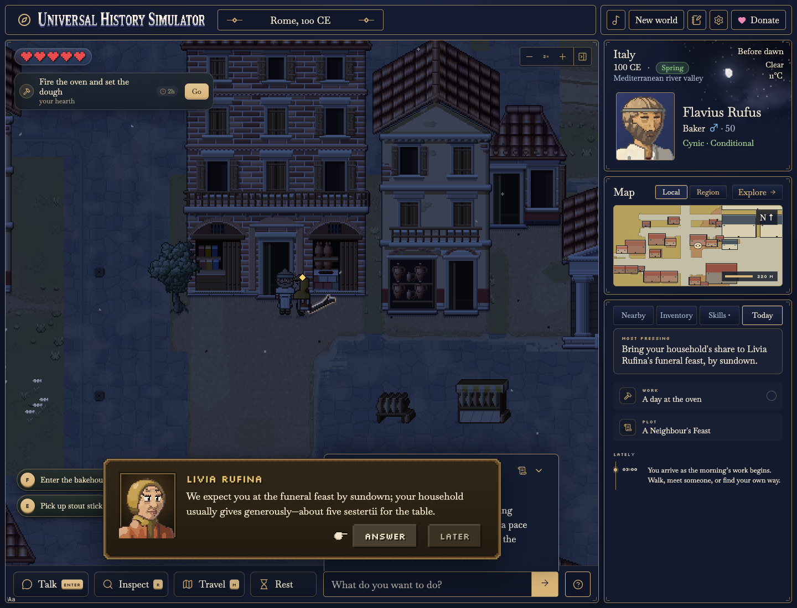
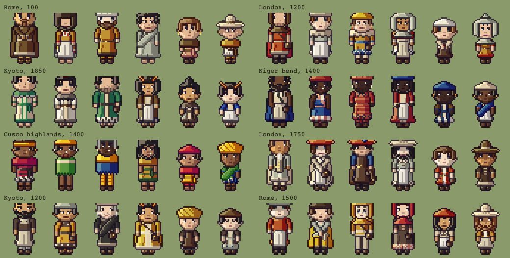
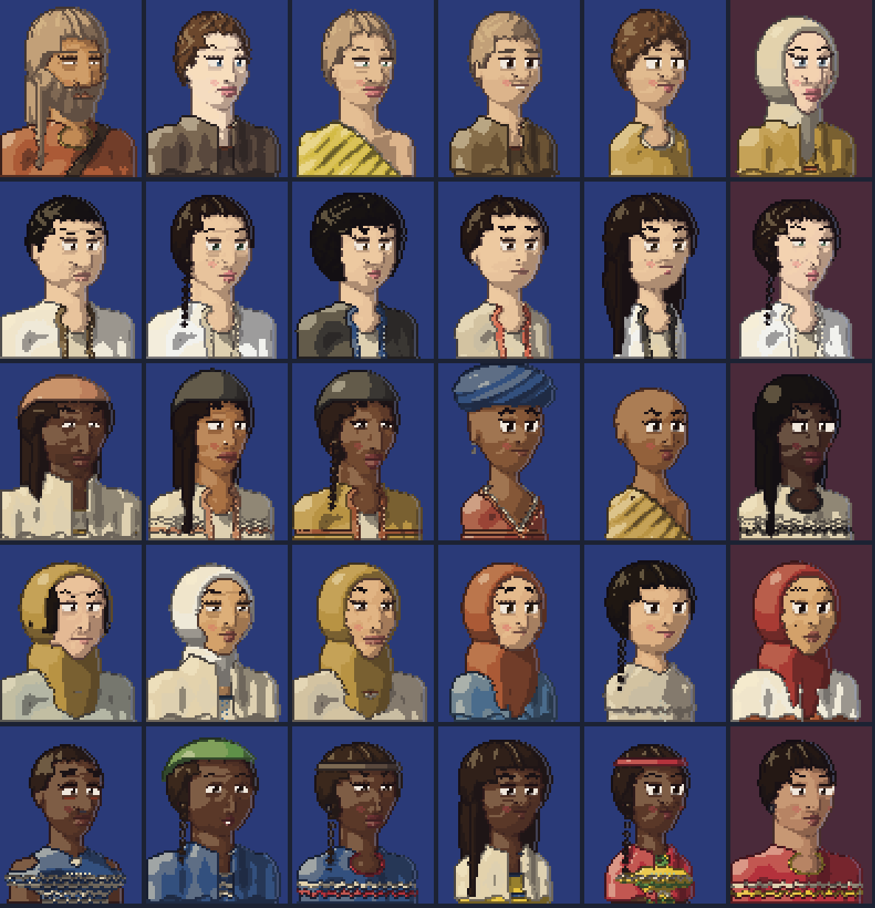

# Universal History Simulator

[](LICENSE)


Universal History Simulator is a free, experimental game and educational
resource that I’m developing as a history professor interested in AI-assisted
historical simulations. You begin with a person, place and date — “a baker in
Ostia, 100 CE,” for example — and explore a generated world through the
activities and obligations of an ordinary life. GPT-6 Luna powers the NPC
dialogue and the narrator.

The project is intended for both human and AI players. A student or someone
interested in history can play through the browser; an AI agent can observe
and act within the same simulation through a programmatic interface. Alongside
the game’s educational possibilities, I’m interested in using it to explore
how agents make decisions within historical circumstances. That remains an
open-ended experiment, and the simulation’s historical coverage and level of
detail are uneven.

[Play the current version](https://historysimulator.vercel.app)



## Game structure

A starting description establishes a character, household and local setting.
A local parser, or an optional model-assisted interpreter, resolves the place
and date. Geographic data helps establish the landscape, while historical
profiles and procedural generation supply settlements, buildings, occupations,
clothing and daily situations.

You move through a pixel-art world, talk with residents, work, trade, manage
possessions and respond to household and community obligations. Residents
follow work and home routines, exchange finite quantities of goods, gossip,
remember favours and react to theft. Actions consume time and affect the
simulation, while a region map supports travel beyond the starting settlement.

Historical content distinguishes documented evidence, inference, hypothesis
and fiction, with those distinctions shown in the game. This is a way to make
the simulation’s assumptions more visible; it does not mean that every
generated detail is accurate or that the historical evidence is complete.

## What currently works

- Browser play with generated settings across twelve broad eras, from
  prehistory to the present.
- Characters, households, occupations, resident routines, dialogue, daily
  tasks, trading and travel.
- Browser saves, exports and command recordings.
- Headless and MCP interfaces through which agents can observe and play.
- An optional classroom mode with activity records and teacher review.

## What is still developing

Current work focuses on terrain and building graphics, the composition of
generated environments, and performance. Historical content also needs
continued correction and expansion: supporting a setting does not mean every
aspect of its daily life is represented equally well.

The larger ambition is to develop the shared human-and-agent environment into
an exploratory platform: comparing playthroughs, examining the assumptions
behind decisions, and finding useful ways to incorporate those records into
teaching and research. The interfaces exist; the methods for making sense of
that play are still to be developed.

<table>
  <tr>
    <td width="50%"></td>
    <td width="50%"></td>
  </tr>
  <tr>
    <td align="center"><sub>Generated characters with dress selected by place, date, age and wealth</sub></td>
    <td align="center"><sub>Generated portraits as shown in the sidebar</sub></td>
  </tr>
</table>

## Running locally

Requires Node 22.12+. No account, API key or Python is needed to play.

```bash
npm ci
npm run dev
```

Open the URL Vite prints. `npm run build` produces `dist/`.

### Controls

| | |
|---|---|
| Move | Arrow keys / WASD, or click to walk |
| Talk / Inspect | Enter / R, or select a person or object |
| Region map | M |
| Inventory · Notebook | I · J |
| Wait | Space (one minute) or the Rest button |

The command bar also accepts short commands such as `wait 10` or `eat bread`.

## How it works

The simulation is deterministic TypeScript, separate from the renderer: the
same seed and commands always produce the same world.

| Path | Role |
|---|---|
| `src/core` | State, action rules, time, visibility, randomness, pathfinding. No browser or historical content. |
| `src/content` | Geography, eras, cultures, professions, wardrobe, plots and card text. |
| `src/world/v2`, `v3` | The region atlas and the local scene: terrain, water, settlements, buildings. |
| `src/runtime` | Commands, worker bridge, persistence, replay. |
| `src/render` | The Phaser view. It draws the world and never decides outcomes. |
| `scripts/` | Art pipeline, geography preparation, capture and headless tools. |

Worlds are saved in the browser and can be exported, along with a full command
recording that replays exactly. The same engine runs headless
(`npm run headless`) and as an MCP server (`npm run mcp`) so agents can observe
and act in a world.

## Classroom mode

`/edumode` is an opt-in entry point for teaching. Students enter a name and
class code, see what will be recorded and choose to start; teachers review
timelines and export them from `/edumode/teacher`. It needs a Postgres database
and three server-side environment variables — see
[docs/CLASSROOM.md](docs/CLASSROOM.md).

## Documentation

Design notes live in [`docs/`](docs). Start with
[UHS_DESIGN.md](docs/UHS_DESIGN.md) for architecture,
[HISTORY.md](docs/HISTORY.md) for eras and content, and
[PROGRESS.md](docs/PROGRESS.md) for recent work.

## Development

```bash
npm run check   # typecheck, unit tests and production build
npm test        # unit tests only
```

## License

Code is released under the [MIT License](LICENSE). Some third-party art and
data keep their own terms; see [ASSET_PROVENANCE.md](docs/ASSET_PROVENANCE.md).
